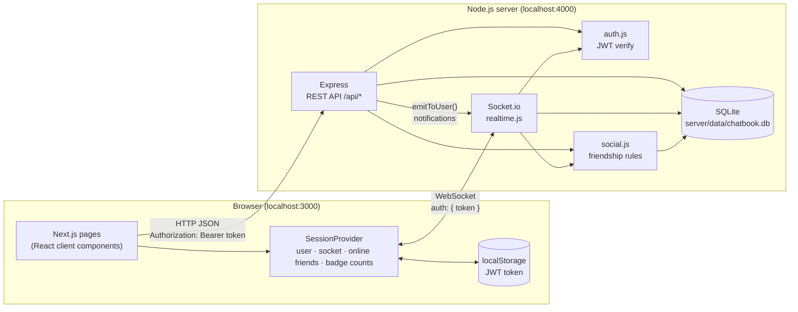
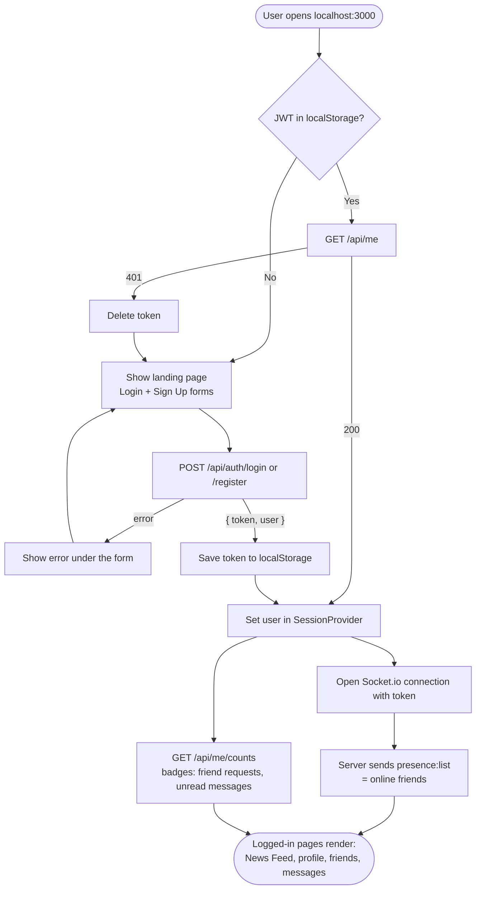
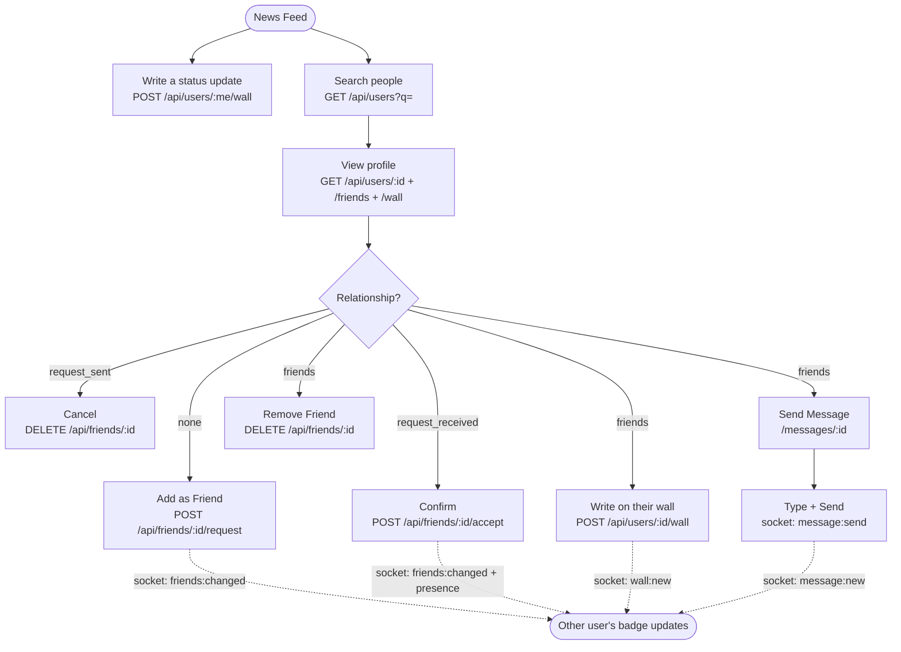
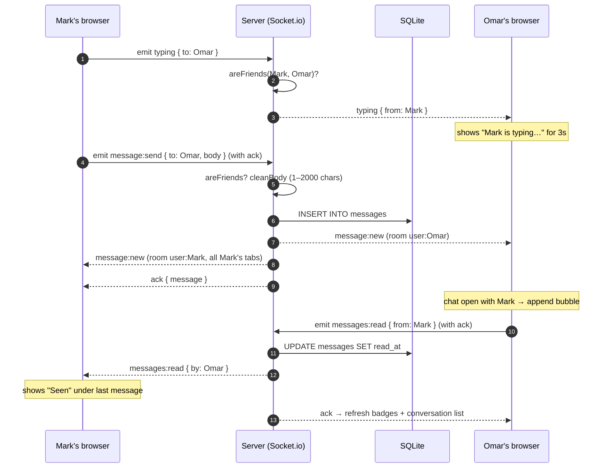

# Architecture

Chatbook is a small social network in the style of the earliest social sites: profiles, friends, walls, a news feed and real-time 1:1 chat between friends. It is split into two independent apps that talk over HTTP and WebSockets.

| Part | Folder | Runs on | Docs |
| --- | --- | --- | --- |
| Frontend (Next.js) | [`web/`](../web) | http://localhost:3000 | [FRONTEND.md](FRONTEND.md) |
| Backend REST API (Express) | [`server/`](../server) | http://localhost:4000/api | [BACKEND.md](BACKEND.md) |
| Realtime (Socket.io) | [`server/src/realtime.js`](../server/src/realtime.js) | ws://localhost:4000 | [REALTIME.md](REALTIME.md) |
| Database (SQLite) | `server/data/chatbook.db` | in-process | [DATABASE.md](DATABASE.md) |
| Test data | [`server/src/seed-data.js`](../server/src/seed-data.js) | `npm run seed` | [TEST_ACCOUNTS.md](TEST_ACCOUNTS.md) |

## Tech stack

| Layer | Technology | Version | Why |
| --- | --- | --- | --- |
| Runtime | Node.js | ≥ 22.13 (dev: 22.22) | Runs both apps; provides the built-in `node:sqlite` module |
| Frontend framework | [Next.js](https://nextjs.org) (App Router, Turbopack) | 16.4 | Routing, dev server, production build |
| UI library | React | 19.3 | Components and state |
| Realtime client | socket.io-client | 4.8 | WebSocket connection to the backend |
| Styling | Plain CSS ([`globals.css`](../web/app/globals.css)) | — | One stylesheet, retro blue look, no CSS framework |
| HTTP server | [Express](https://expressjs.com) | 5.3 | REST API, JSON parsing, error handling |
| Realtime server | [Socket.io](https://socket.io) | 4.8 | Chat, presence, typing, notifications |
| Database | SQLite via `node:sqlite` (`DatabaseSync`) | built into Node | Zero-setup file database, synchronous queries |
| Password hashing | bcryptjs | 3.0 | Pure-JS bcrypt, no native build |
| Auth tokens | jsonwebtoken (JWT, HS256) | 9.0 | Stateless sessions, 7-day expiry |
| CORS | cors | 2.8 | Lets the frontend on :3000 call the API on :4000 |
| Dev tooling | concurrently | 9.2 | `npm run dev` starts both apps in one terminal |

Everything is plain JavaScript (ES modules on the server, JSX in the web app); there is no TypeScript or build step on the server.

## Repository layout

```
chat application/
├── package.json            # root scripts: install:all, dev, seed, docs:accounts, bench
├── bench/bench.js          # small sequential benchmark (npm run bench)
├── README.md               # quick start
├── docs/                   # ← you are here
├── server/                 # Node.js backend
│   ├── package.json
│   ├── data/               # SQLite file (git-ignored, created on first run)
│   └── src/
│       ├── index.js        # entry: Express app + HTTP server + Socket.io
│       ├── config.js       # env-based settings (port, origin, secret, db path)
│       ├── db.js           # opens SQLite, creates tables, user helpers
│       ├── auth.js         # JWT sign/verify, requireAuth middleware
│       ├── social.js       # friendship queries, input validation, httpError
│       ├── routes.js       # all REST endpoints under /api
│       ├── realtime.js     # Socket.io: chat, presence, typing, emitToUser
│       ├── seed-data.js    # demo accounts, friendships, posts, messages
│       ├── seed.js         # wipes + fills the database from seed-data.js
│       └── gen-accounts-doc.js  # writes docs/TEST_ACCOUNTS.md
└── web/                    # Next.js frontend
    ├── package.json
    ├── next.config.mjs     # pins Turbopack root to web/
    ├── jsconfig.json       # "@/..." import alias
    ├── lib/api.js          # fetch wrapper, token storage, timeAgo
    ├── components/         # SessionProvider, AppShell, Inbox, Wall, ...
    └── app/                # routes (one folder per URL)
```

## System overview



Two channels connect the apps:

- **REST (HTTP + JSON)** for everything that reads or changes data on request: auth, profiles, friends, walls, feed, conversation history.
- **Socket.io (WebSocket)** for things that must arrive without a page refresh: new chat messages, read receipts, typing, friends coming online/offline, and "something changed" nudges after friend requests or wall posts.

Chat messages are *sent* over the socket (with an acknowledgement) and *loaded* over REST.

## How the software works

### Page load and login



### What a user can do



### Sending a chat message (end to end)



More detail on each step is in [REALTIME.md](REALTIME.md).

## Security model (in short)

- Passwords are hashed with bcrypt (10 rounds); hashes are never sent to clients (`publicUser()` strips them).
- Every `/api/*` route except register/login requires `Authorization: Bearer <JWT>`; sockets require the same token in the handshake.
- Friendship rules are enforced on the server, not only in the UI: only friends can chat or write on each other's walls, and non-friends see a reduced profile (name + hometown).
- Inputs are length-limited (posts 1000 chars, messages 2000, JSON body 100 KB) and SQL uses prepared statements throughout.
- **Before deploying:** set `JWT_SECRET`, put the API behind HTTPS, and set `CLIENT_ORIGIN` / `NEXT_PUBLIC_API_URL` to the real hosts. There is no rate limiting or email verification yet.
