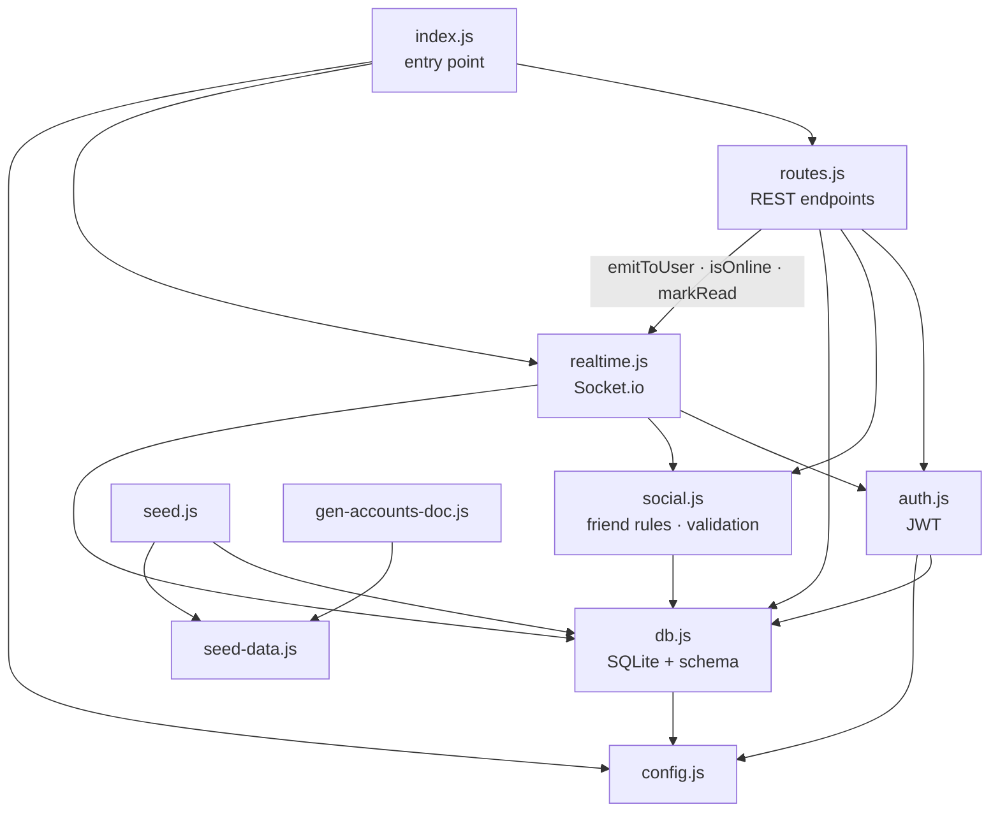
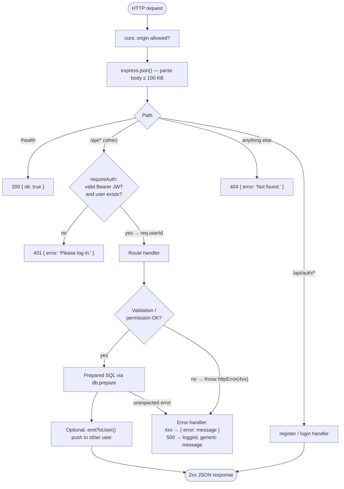
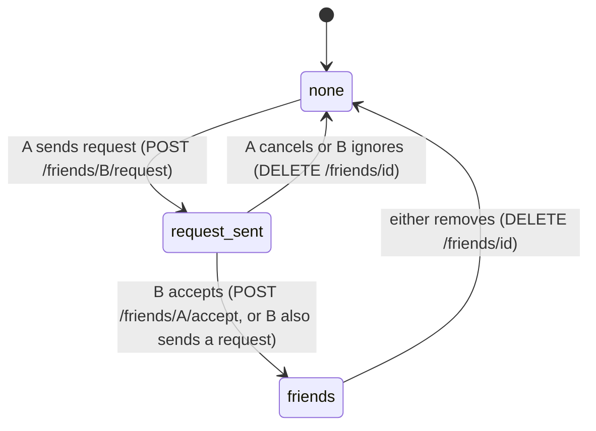

# Backend (`server/`)

A single Node.js process that serves the REST API (Express 5) and the realtime channel (Socket.io 4) on the same port, backed by an SQLite file via Node's built-in `node:sqlite`.

See also: [DATABASE.md](DATABASE.md) for tables, [REALTIME.md](REALTIME.md) for socket events, [ARCHITECTURE.md](ARCHITECTURE.md) for the big picture.

## What we use

| Package | Used in | For |
| --- | --- | --- |
| `express` 5 | `index.js`, `routes.js` | HTTP server, routing, JSON body parsing. Express 5 forwards thrown errors to the error handler, so routes just `throw httpError(...)`. |
| `socket.io` 4 | `realtime.js` | WebSocket server with rooms and acknowledgements |
| `node:sqlite` (`DatabaseSync`) | `db.js` | Synchronous SQLite access — no separate database server |
| `bcryptjs` | `routes.js`, `seed.js` | Hashing and checking passwords |
| `jsonwebtoken` | `auth.js` | Signing/verifying login tokens |
| `cors` | `index.js` | Allowing the web app's origin to call the API |

## Scripts

Run from `server/` (or from the repo root with `--prefix server`).

| Script | Command | What it does |
| --- | --- | --- |
| `npm run dev` | `node --watch src/index.js` | Starts the API and restarts on file changes |
| `npm start` | `node src/index.js` | Starts the API without watching |
| `npm run seed` | `node src/seed.js` | Wipes the DB and loads [test data](TEST_ACCOUNTS.md) |
| `npm run docs:accounts` | `node src/gen-accounts-doc.js` | Regenerates `docs/TEST_ACCOUNTS.md` |

`--disable-warning=ExperimentalWarning` hides Node's "SQLite is experimental" notice.

## Configuration ([`config.js`](../server/src/config.js))

| Env var | Default | Meaning |
| --- | --- | --- |
| `PORT` | `4000` | Port for both HTTP and Socket.io |
| `CLIENT_ORIGIN` | `http://localhost:3000` | Allowed CORS origin(s), comma-separated |
| `JWT_SECRET` | `dev-secret-change-me` | Secret for signing tokens — **change in production** |
| `DB_PATH` | `server/data/chatbook.db` | SQLite file location |

## Modules



| File | Responsibility | Key exports |
| --- | --- | --- |
| [`index.js`](../server/src/index.js) | Builds the Express app (CORS, JSON parser 100 KB limit, `/health`, `/api` router, 404 and error handlers), wraps it in an `http.Server`, attaches Socket.io, listens on `PORT`. | — |
| [`config.js`](../server/src/config.js) | Reads env vars with defaults. | `PORT`, `CLIENT_ORIGIN`, `JWT_SECRET`, `DB_PATH` |
| [`db.js`](../server/src/db.js) | Opens the database (WAL mode, foreign keys on) and creates tables/indexes if missing. | `db`, `now()`, `getUser(id)`, `publicUser(row)`, `PROFILE_FIELDS` |
| [`auth.js`](../server/src/auth.js) | Issues 7-day JWTs (`sub` = user id) and validates them (also checks the user still exists). | `signToken`, `verifyToken`, `requireAuth` |
| [`social.js`](../server/src/social.js) | Friendship lookups and shared validation. | `getFriendship`, `areFriends`, `relationship`, `friendIds`, `cleanBody`, `httpError` |
| [`routes.js`](../server/src/routes.js) | Every REST endpoint (table below). | `router` |
| [`realtime.js`](../server/src/realtime.js) | Socket auth, presence tracking, chat send/read/typing, and helpers routes use to push events. | `attachRealtime`, `emitToUser`, `isOnline`, `insertMessage`, `markRead` |
| [`seed-data.js`](../server/src/seed-data.js) / [`seed.js`](../server/src/seed.js) | Demo data and the script that validates and loads it in one transaction. | — |
| [`gen-accounts-doc.js`](../server/src/gen-accounts-doc.js) | Turns seed data into `docs/TEST_ACCOUNTS.md`. | — |

## Request lifecycle



All responses are JSON. Errors always look like `{ "error": "Human-readable message" }`.

## REST API reference

Base URL: `http://localhost:4000/api`. All routes except the two auth routes need `Authorization: Bearer <token>`.

### Auth

| Method | Path | Body | Response | Notes |
| --- | --- | --- | --- | --- |
| POST | `/auth/register` | `{ name, email, password }` | `201 { token, user }` | Name 2–60 chars, valid email, password ≥ 6. `409` if email taken. |
| POST | `/auth/login` | `{ email, password }` | `{ token, user }` | `401` on wrong email or password (same message for both). |

### Current user

| Method | Path | Body | Response |
| --- | --- | --- | --- |
| GET | `/me` | — | `{ user }` |
| PUT | `/me` | any of `name, sex, birthday, hometown, relationship_status, interests, about_me` | `{ user }` (fields trimmed, max 1000 chars) |
| GET | `/me/counts` | — | `{ friendRequests, unreadMessages }` for header badges |

### Users, profiles and walls

| Method | Path | Response | Rules |
| --- | --- | --- | --- |
| GET | `/users?q=text` | `{ users: [...user, relationship] }` | Matches name, hometown or interests; max 50 |
| GET | `/users/:id` | `{ user (+online), relationship, friendCount }` | Non-friends only get name, hometown, created_at |
| GET | `/users/:id/friends` | `{ friends: [...user, online] }` | Sorted by name |
| GET | `/users/:id/wall` | `{ posts }` | Newest first, max 100 |
| POST | `/users/:id/wall` | `201 { post }` | Body `{ body }` 1–1000 chars. Only on your own or a friend's wall (`403` otherwise). Pushes `wall:new` to the wall owner. |
| DELETE | `/posts/:id` | `{ ok: true }` | Author or wall owner only |
| GET | `/feed` | `{ posts }` | Posts written by or on the wall of you or any friend; newest 100 |

`relationship` is one of `self`, `friends`, `request_sent`, `request_received`, `none`.

### Friends

| Method | Path | Response | Notes |
| --- | --- | --- | --- |
| GET | `/friends` | `{ friends }` | Online friends first |
| GET | `/friends/requests` | `{ incoming, outgoing }` | Pending only |
| POST | `/friends/:id/request` | `{ relationship }` | If they already asked you, this accepts instead. Pushes `friends:changed`. |
| POST | `/friends/:id/accept` | `{ relationship: 'friends' }` | Only the addressee can accept. Pushes `friends:changed` and `presence` to both. |
| DELETE | `/friends/:id` | `{ relationship: 'none' }` | Unfriend, decline, or cancel — whichever applies. |

### Friend request state machine



### Messages

| Method | Path | Response | Notes |
| --- | --- | --- | --- |
| GET | `/conversations` | `{ conversations: [{ ...lastMessage, partner_id, partner_name, unread, online }] }` | One row per person you've messaged, newest first |
| GET | `/messages/:id` | `{ partner, relationship, messages }` | Last 200 messages, oldest first. **Marks their messages to you as read** and pushes `messages:read` to them. |

Sending is done over the socket (`message:send`), see [REALTIME.md](REALTIME.md).

## Example

```bash
curl -s -X POST http://localhost:4000/api/auth/login -H 'Content-Type: application/json' -d '{"email":"mark@chatbook.test","password":"<see docs/TEST_ACCOUNTS.md>"}'
```

```bash
curl -s http://localhost:4000/api/feed -H "Authorization: Bearer <token from login>"
```
