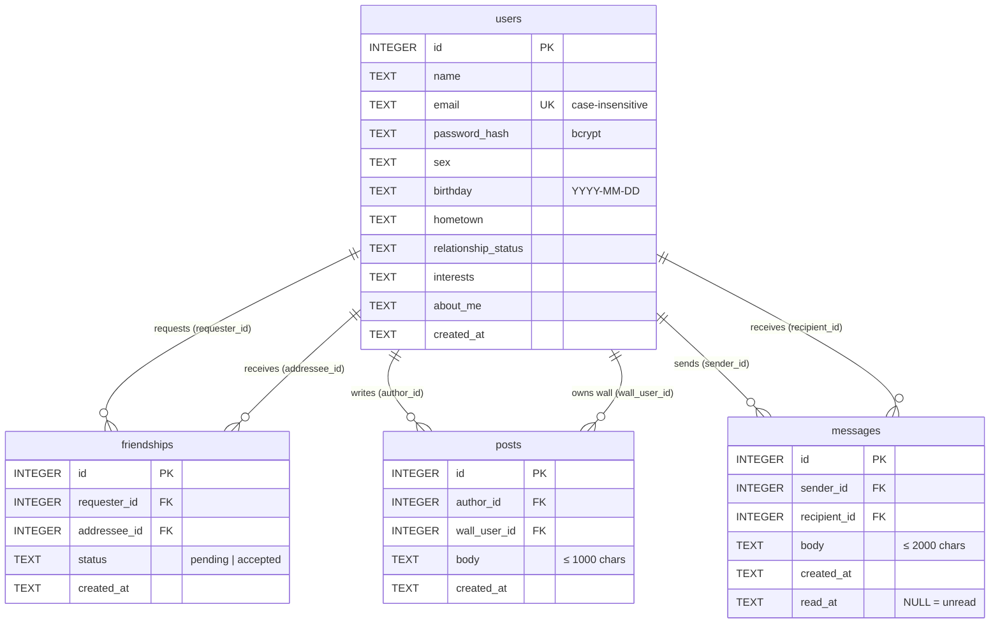

# Database

SQLite, opened through Node's built-in [`node:sqlite`](https://nodejs.org/api/sqlite.html) module (`DatabaseSync`, synchronous API). The schema lives in [`server/src/db.js`](../server/src/db.js) and is created automatically (`CREATE TABLE IF NOT EXISTS`) every time the server or seed script starts — there are no migrations.

| Setting | Value |
| --- | --- |
| File | `server/data/chatbook.db` (override with `DB_PATH`); git-ignored |
| Journal mode | WAL (creates `chatbook.db-wal` / `-shm` alongside) |
| Foreign keys | On — deleting a user cascades to their friendships, posts and messages |
| Timestamps | ISO-8601 UTC strings from `new Date().toISOString()` |
| Reset | `npm run seed` deletes all rows and loads [test data](TEST_ACCOUNTS.md); deleting the file also works |

## Entity relationship diagram



## Tables

### `users`
One row per account. Profile fields default to `''`. `email` is `UNIQUE COLLATE NOCASE` and stored lower-cased. `password_hash` never leaves the server — `publicUser()` strips it from every response.

### `friendships`
**One row per pair of users**, never two. Who sent the request is kept in `requester_id` / `addressee_id`:

| status | meaning |
| --- | --- |
| `pending` | `requester_id` asked `addressee_id` to be friends |
| `accepted` | they are friends (direction no longer matters) |

Declining, cancelling and unfriending all **delete** the row. `UNIQUE (requester_id, addressee_id)` blocks duplicates in one direction; the API checks the reverse direction with `getFriendship(a, b)` before inserting.

### `posts`
Wall posts. `author_id` wrote on `wall_user_id`'s wall. When both are the same user it is a status update ("Mark Lee is excited…").

### `messages`
Private 1:1 chat messages. `read_at` is set when the recipient opens the conversation or reads it live.

## Indexes

| Index | Columns | Speeds up |
| --- | --- | --- |
| `idx_posts_wall` | `posts (wall_user_id, id)` | Profile walls |
| `idx_posts_author` | `posts (author_id, id)` | News feed |
| `idx_messages_pair` | `messages (sender_id, recipient_id, id)` | Loading a conversation |
| `idx_messages_recipient` | `messages (recipient_id, read_at)` | Unread counts |

## Notable queries

**Friend ids of a user** ([`social.js`](../server/src/social.js)) — pick "the other side" of each accepted row:
```sql
SELECT CASE WHEN requester_id = :me THEN addressee_id ELSE requester_id END AS id
FROM friendships
WHERE status = 'accepted' AND (requester_id = :me OR addressee_id = :me);
```

**Inbox / conversation list** ([`routes.js`](../server/src/routes.js)) — group messages by partner, take the latest one, and count unread:
```sql
SELECT m.*, u.id AS partner_id, u.name AS partner_name,
       (SELECT COUNT(*) FROM messages x
        WHERE x.sender_id = u.id AND x.recipient_id = :me AND x.read_at IS NULL) AS unread
FROM (SELECT CASE WHEN sender_id = :me THEN recipient_id ELSE sender_id END AS partner,
             MAX(id) AS last_id
      FROM messages WHERE sender_id = :me OR recipient_id = :me
      GROUP BY partner) c
JOIN messages m ON m.id = c.last_id
JOIN users u ON u.id = c.partner
ORDER BY m.id DESC;
```

**News feed** — posts written by, or on the wall of, me or any friend:
```sql
SELECT ... FROM posts p
WHERE p.author_id IN (:me, ...friendIds) OR p.wall_user_id IN (:me, ...friendIds)
ORDER BY p.id DESC LIMIT 100;
```

## Inspecting the data

The `sqlite3` CLI isn't required; Node can query it directly:

```bash
node --disable-warning=ExperimentalWarning -e "const {DatabaseSync}=require('node:sqlite'); const db=new DatabaseSync('server/data/chatbook.db'); console.table(db.prepare('SELECT id,name,email FROM users').all())"
```
