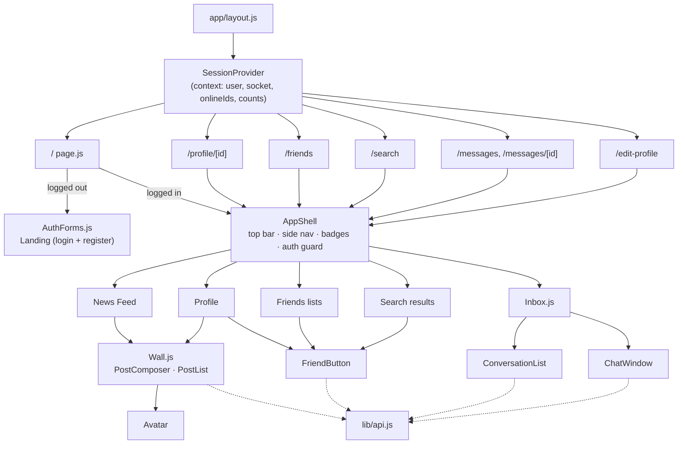
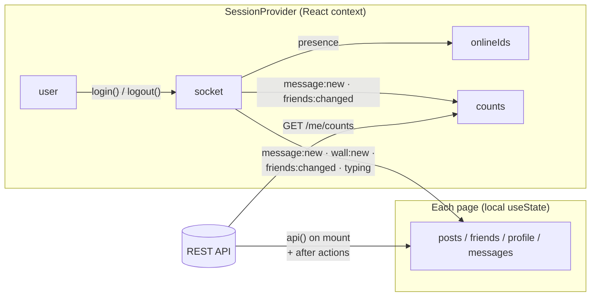
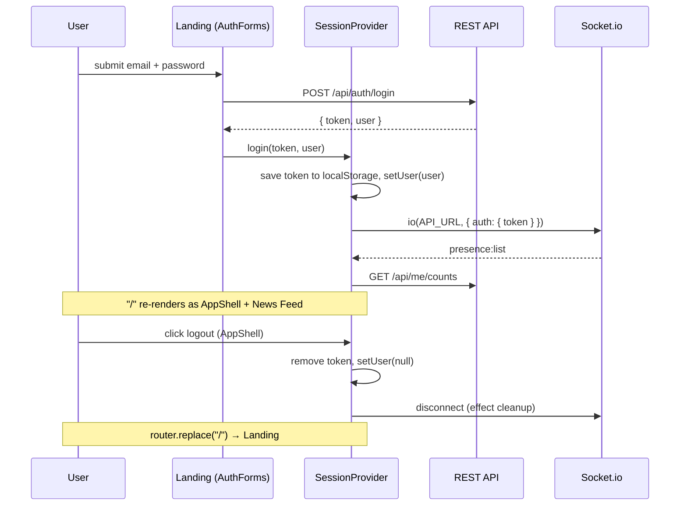

# Frontend (`web/`)

A Next.js 16 app using the **App Router**. Every page is a client component (`'use client'`): the login token lives in `localStorage`, so pages render in the browser and fetch data from the API at `http://localhost:4000` (override with `NEXT_PUBLIC_API_URL`).

See also: [BACKEND.md](BACKEND.md) for the endpoints these pages call, [REALTIME.md](REALTIME.md) for socket events.

## What we use

| Package / feature | For |
| --- | --- |
| `next` 16 (Turbopack dev server) | File-based routing, dev server with hot reload, production build |
| `react` / `react-dom` 19 | Components, hooks (`useState`, `useEffect`, `useCallback`, `useContext`) |
| `socket.io-client` 4 | Realtime connection (opened once in `SessionProvider`) |
| `next/link`, `next/navigation` | Client navigation, `useRouter`, `useParams`, `useSearchParams`, `usePathname` |
| Plain CSS ([`app/globals.css`](../web/app/globals.css)) | All styling — CSS variables for the blue palette, grid layouts, a 720 px breakpoint for phones |
| `jsconfig.json` | The `@/` import alias (e.g. `@/components/Avatar`) |
| `next.config.mjs` | Pins `turbopack.root` to `web/` (the repo root has its own lockfile) |

## Scripts

| Script | What it does |
| --- | --- |
| `npm run dev` | Dev server on port 3000 with hot reload |
| `npm run build` | Production build into `.next/` |
| `npm start` | Serve the production build on port 3000 |

## Routes

| URL | File | Shows | API calls |
| --- | --- | --- | --- |
| `/` | [`app/page.js`](../web/app/page.js) | Logged out: landing with Login + Sign Up. Logged in: News Feed, status composer, Online Friends | `GET /feed`, `GET /friends`, `POST /users/:me/wall` |
| `/profile/[id]` | [`app/profile/[id]/page.js`](../web/app/profile/[id]/page.js) | Avatar, friend/message buttons, Information table, Friends grid, The Wall | `GET /users/:id`, `/users/:id/friends`, `/users/:id/wall` |
| `/friends` | [`app/friends/page.js`](../web/app/friends/page.js) | Incoming requests, my friends, requests I sent | `GET /friends`, `GET /friends/requests` |
| `/search?q=` | [`app/search/page.js`](../web/app/search/page.js) | Search box + results with friend buttons | `GET /users?q=` |
| `/messages` | [`app/messages/page.js`](../web/app/messages/page.js) | Inbox: conversation list, empty chat panel | `GET /conversations`, `GET /friends` |
| `/messages/[id]` | [`app/messages/[id]/page.js`](../web/app/messages/[id]/page.js) | Inbox with the chat with user `id` open | `+ GET /messages/:id`, socket chat events |
| `/edit-profile` | [`app/edit-profile/page.js`](../web/app/edit-profile/page.js) | Profile form | `PUT /me` |

[`app/layout.js`](../web/app/layout.js) wraps every route in `<SessionProvider>` and loads `globals.css`.

## Component tree

## Components

| File | What it does |
| --- | --- |
| [`components/SessionProvider.js`](../web/components/SessionProvider.js) | The app's global state. On mount: if a token exists, `GET /me` to restore the user. When a user is set: opens the Socket.io connection, tracks `onlineIds` from `presence:list` / `presence`, and keeps `counts` (badges) fresh on `message:new`, `messages:read`, `friends:changed`. Exposes `login`, `logout`, `refreshCounts`, `setUser` via `useSession()`. |
| [`components/AppShell.js`](../web/components/AppShell.js) | Layout for logged-in pages: blue top bar, quick search, side nav with badges. Redirects to `/` if there's no user. |
| [`components/AuthForms.js`](../web/components/AuthForms.js) | Landing page with Login and Sign Up forms; on success calls `login(token, user)`. |
| [`components/Wall.js`](../web/components/Wall.js) | `PostComposer` (textarea → `POST /users/:id/wall`) and `PostList` (posts with "X wrote on Y's wall", time ago, delete). |
| [`components/FriendButton.js`](../web/components/FriendButton.js) | Shows Add / Cancel / Confirm + Ignore / Remove depending on `relationship`, calls the friends API, reports the new relationship. |
| [`components/Inbox.js`](../web/components/Inbox.js) | `ConversationList` (conversations + friends you haven't messaged, unread badges, online dots) and `ChatWindow` (history, bubbles, typing indicator, "Seen", send box). |
| [`components/Avatar.js`](../web/components/Avatar.js) | Coloured square with initials (colour picked from user id) and an optional online dot. |
| [`lib/api.js`](../web/lib/api.js) | `api(path, { method, body })` fetch wrapper (adds JSON + Bearer token, throws `Error(data.error)` on non-2xx), `getToken`/`setToken` (localStorage, wrapped in try/catch), `timeAgo()`. |

## State and data flow

- **Global** (in context): who is logged in, the single socket, which friends are online, header badge counts.
- **Per page**: each page loads its own data with `api()` in a `useEffect` and keeps it in local state. After an action (post, accept friend, …) it updates local state from the response, or reloads.
- **Live updates**: pages subscribe to socket events in a `useEffect` (`socket.on` / `socket.off` in the cleanup) and reload or patch their state.

## Login / logout flow

## Styling

All styles are in [`app/globals.css`](../web/app/globals.css), grouped by area (top bar, boxes, buttons, forms, wall posts, profile, people lists, messages). Colours are CSS variables on `:root` (`--blue: #3b5998`, `--blue-light`, `--blue-pale`, …). Under 720 px wide the multi-column layouts collapse to one column and the inbox stacks the conversation list above the chat.

## Adding a page

1. Create `web/app/<route>/page.js` starting with `'use client'`.
2. Wrap the content in `<AppShell>` if it needs a logged-in user.
3. Use `useSession()` for the user/socket and `api()` for data.
4. Add a link in `AppShell`'s `nav` list if it belongs in the side menu.
