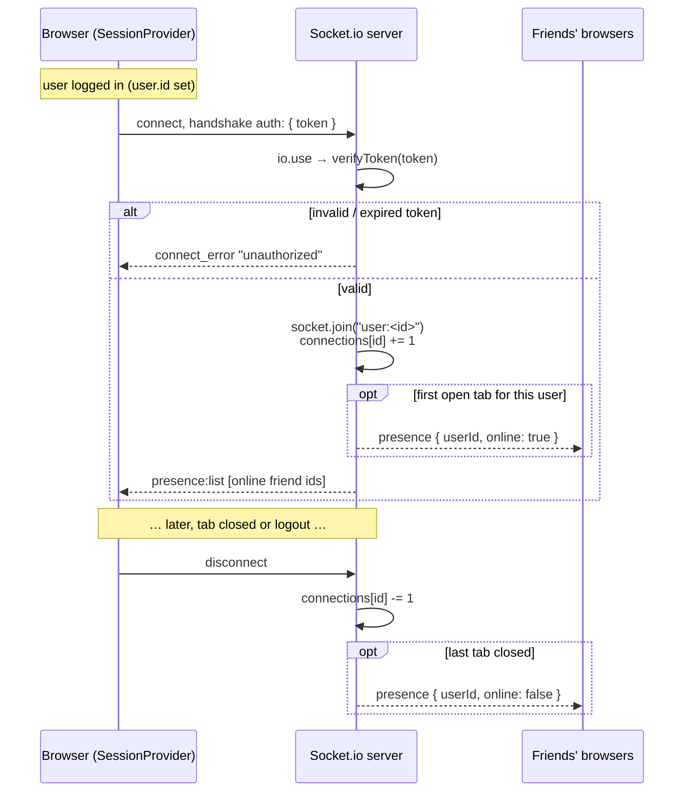
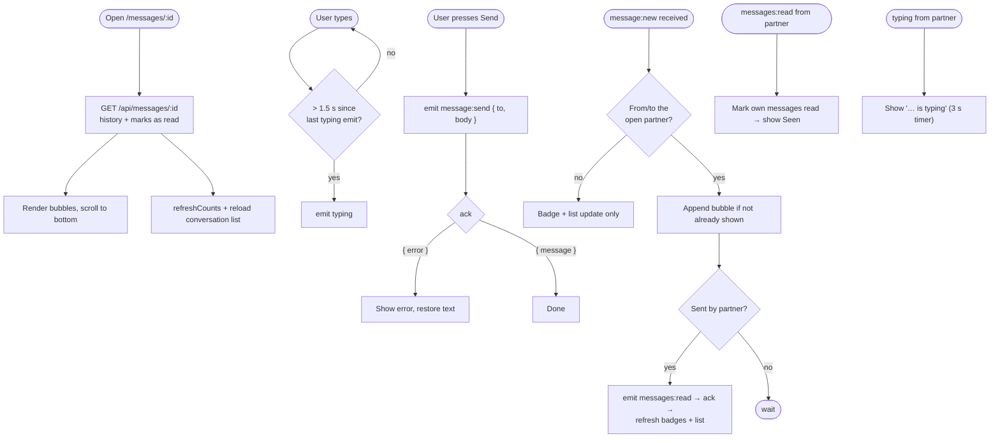

# Realtime (Socket.io)

Live features — chat, read receipts, typing, online presence and badge updates — run over a Socket.io connection between the browser and the server on port 4000.

- Server: [`server/src/realtime.js`](../server/src/realtime.js)
- Client: [`web/components/SessionProvider.js`](../web/components/SessionProvider.js) (connection, presence, badges) and [`web/components/Inbox.js`](../web/components/Inbox.js) (chat)

## Connection and authentication

Key ideas:

- **One room per user** (`user:<id>`). Every tab a user has open joins the same room, so `emitToUser(id, …)` reaches all of them. The sender's own `message:new` echo is how their other tabs stay in sync.
- **Presence is in memory**: `connections` is a `Map<userId, openSocketCount>`. A user is online while the count is > 0. It resets when the server restarts (clients reconnect automatically and re-announce).
- Presence events only go to **friends** (`friendIds()`), never to strangers.

## Events

### Client → server

| Event | Payload | Ack | Server does |
| --- | --- | --- | --- |
| `message:send` | `{ to, body }` | `{ message }` or `{ error }` | Checks `areFriends`, validates 1–2000 chars, inserts, emits `message:new` to both users |
| `messages:read` | `{ from }` | `()` | Marks all unread messages from `from` as read; emits `messages:read` to `from` if anything changed |
| `typing` | `{ to }` | — | If friends, emits `typing` to `to` |

### Server → client

| Event | Payload | Sent when | Client reaction |
| --- | --- | --- | --- |
| `presence:list` | `number[]` | Right after connecting | Replace the set of online friend ids |
| `presence` | `{ userId, online }` | A friend's first tab opens / last tab closes; also after a friend request is accepted | Add/remove from online set → green dots update |
| `message:new` | message row | Any message to or from you | Refresh badges; inbox reloads list; open chat appends bubble |
| `messages:read` | `{ by }` | The other person read your messages | Show "Seen"; refresh lists |
| `typing` | `{ from }` | A friend is typing to you | Show "… is typing" for 3 s |
| `friends:changed` | `{}` | Someone sent/accepted/cancelled/removed a friendship with you | Refresh badges; friends page reloads |
| `wall:new` | post row | A friend wrote on your wall | News feed reloads |

The last two are pushed from REST routes through `emitToUser()`, so an HTTP action by one user shows up instantly for another.

## Chat flow in the UI

## Why sending goes over the socket, not REST

Using `socket.emit('message:send', data, ack)` gives one round trip that both stores the message and returns success/failure, while the same server code fans the message out to the recipient's and sender's rooms. History still loads over REST (`GET /api/messages/:id`) because it is a normal request/response and is easy to cache or paginate later.

## Limits and future work

- Presence and rooms live in a single process. To run several server instances you'd add the [Socket.io Redis adapter](https://socket.io/docs/v4/redis-adapter/) and move the presence map to Redis.
- While the socket is disconnected, Socket.io buffers emitted messages and sends them on reconnect, but the UI shows no "connecting…" or "pending" state, and buffered messages are lost if the tab is closed first.
- Typing events are throttled to one per 1.5 s per sender.
