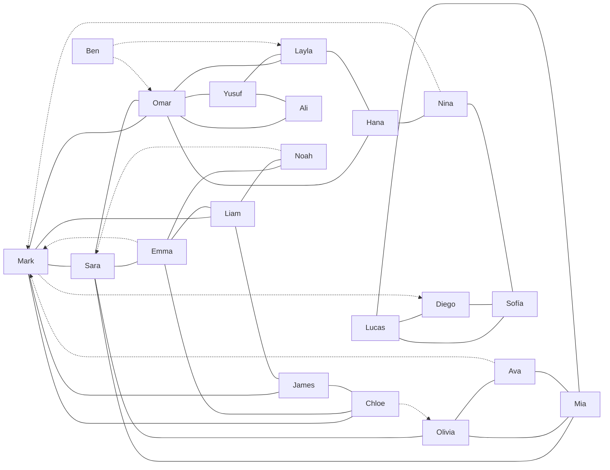

# Test accounts

> Generated from `server/src/seed-data.js` by `npm run docs:accounts`. Edit the seed data, not this file.

Load these accounts into the local database with `npm run seed` (from the repo root). Seeding **wipes all existing data** first.

All accounts use the password **`password123`**. These are local test accounts only — never reuse this password anywhere real.

**Totals:** 20 users · 31 friendships · 8 pending friend requests · 20 wall posts · 81 messages in 17 conversations.

## Accounts

| ID | Name | Email | Hometown | Friends | Requests in / out | Unread messages |
| --: | --- | --- | --- | --: | :-: | --: |
| 1 | Mark Lee | `mark@chatbook.test` | Dobbs Ferry, NY | 5 | 3 / 1 | 3 |
| 2 | Sara Chen | `sara@chatbook.test` | San Francisco, CA | 5 | 1 / 0 | 1 |
| 3 | Omar Haddad | `omar@chatbook.test` | Beirut, Lebanon | 6 | 1 / 0 | — |
| 4 | Emma Brown | `emma@chatbook.test` | Boston, MA | 4 | 0 / 1 | — |
| 5 | Liam Walsh | `liam@chatbook.test` | Dublin, Ireland | 4 | 0 / 0 | — |
| 6 | Noah Kim | `noah@chatbook.test` | Seoul, South Korea | 2 | 0 / 1 | — |
| 7 | Olivia Martin | `olivia@chatbook.test` | Lyon, France | 3 | 1 / 0 | 1 |
| 8 | Ava Rossi | `ava@chatbook.test` | Milan, Italy | 2 | 0 / 1 | — |
| 9 | Lucas Silva | `lucas@chatbook.test` | São Paulo, Brazil | 3 | 0 / 0 | — |
| 10 | Mia Schmidt | `mia@chatbook.test` | Berlin, Germany | 4 | 0 / 0 | — |
| 11 | Yusuf Demir | `yusuf@chatbook.test` | Istanbul, Turkey | 3 | 0 / 0 | — |
| 12 | Layla Nasser | `layla@chatbook.test` | Amman, Jordan | 3 | 1 / 0 | — |
| 13 | Hana Sato | `hana@chatbook.test` | Osaka, Japan | 3 | 0 / 0 | — |
| 14 | Diego García | `diego@chatbook.test` | Madrid, Spain | 2 | 1 / 0 | — |
| 15 | Sofía López | `sofia@chatbook.test` | Mexico City, Mexico | 3 | 0 / 0 | — |
| 16 | James Carter | `james@chatbook.test` | Austin, TX | 3 | 0 / 0 | — |
| 17 | Chloe Dubois | `chloe@chatbook.test` | Montreal, Canada | 3 | 0 / 1 | — |
| 18 | Ali Rahimi | `ali@chatbook.test` | Tehran, Iran | 2 | 0 / 0 | — |
| 19 | Nina Petrova | `nina@chatbook.test` | Sofia, Bulgaria | 2 | 0 / 1 | 1 |
| 20 | Ben Turner | `ben@chatbook.test` | Leeds, UK | 0 | 0 / 2 | — |

## Relationships

### Friends of each user

| User | Friends | Incoming requests from | Sent requests to |
| --- | --- | --- | --- |
| **Mark Lee** | Chloe, James, Liam, Omar, Sara | Emma, Ava, Nina | Diego |
| **Sara Chen** | Emma, Mark, Mia, Olivia, Omar | Noah | — |
| **Omar Haddad** | Ali, Hana, Layla, Mark, Sara, Yusuf | Ben | — |
| **Emma Brown** | Chloe, Liam, Noah, Sara | — | Mark |
| **Liam Walsh** | Emma, James, Mark, Noah | — | — |
| **Noah Kim** | Emma, Liam | — | Sara |
| **Olivia Martin** | Ava, Mia, Sara | Chloe | — |
| **Ava Rossi** | Mia, Olivia | — | Mark |
| **Lucas Silva** | Diego, Mia, Sofía | — | — |
| **Mia Schmidt** | Ava, Lucas, Olivia, Sara | — | — |
| **Yusuf Demir** | Ali, Layla, Omar | — | — |
| **Layla Nasser** | Hana, Omar, Yusuf | Ben | — |
| **Hana Sato** | Layla, Nina, Omar | — | — |
| **Diego García** | Lucas, Sofía | Mark | — |
| **Sofía López** | Diego, Lucas, Nina | — | — |
| **James Carter** | Chloe, Liam, Mark | — | — |
| **Chloe Dubois** | Emma, James, Mark | — | Olivia |
| **Ali Rahimi** | Omar, Yusuf | — | — |
| **Nina Petrova** | Hana, Sofía | — | Mark |
| **Ben Turner** | — | — | Omar, Layla |

### Pending friend requests

| From | To |
| --- | --- |
| Emma Brown | Mark Lee |
| Ava Rossi | Mark Lee |
| Nina Petrova | Mark Lee |
| Mark Lee | Diego García |
| Noah Kim | Sara Chen |
| Chloe Dubois | Olivia Martin |
| Ben Turner | Omar Haddad |
| Ben Turner | Layla Nasser |

### Friendship graph

Solid lines are friendships; dotted arrows are pending requests (from → to).

## Conversations

Messages can only be sent between friends, so every conversation is between two friends.

| Between | Messages | Unread | Last message |
| --- | --: | --- | --- |
| Mark Lee ↔ Sara Chen | 6 | — | Mark: “On it.” |
| Mark Lee ↔ Omar Haddad | 4 | 2 for Mark | Omar: “Bring snacks please 🙏” |
| Mark Lee ↔ Liam Walsh | 3 | 1 for Mark | Liam: “Running 10 min late, sorry!” |
| Mark Lee ↔ James Carter | 2 | — | Mark: “Definitely, good luck!” |
| Mark Lee ↔ Chloe Dubois | 30 | — | Mark: “Ha, maybe!” |
| Sara Chen ↔ Emma Brown | 5 | — | Emma: “Please do, we need band photos!” |
| Sara Chen ↔ Olivia Martin | 3 | 1 for Sara | Olivia: “Come by the studio tomorrow 🎨” |
| Omar Haddad ↔ Yusuf Demir | 4 | — | Omar: “Hang in there, brother.” |
| Omar Haddad ↔ Layla Nasser | 3 | — | Layla: “Perfect, thanks!” |
| Emma Brown ↔ Noah Kim | 4 | — | Emma: “Will do 🎸” |
| Olivia Martin ↔ Ava Rossi | 3 | 1 for Olivia | Ava: “Saturday at 10.” |
| Lucas Silva ↔ Diego García | 3 | — | Diego: “¡Increíble! Drinks on you then.” |
| Diego García ↔ Sofía López | 2 | — | Diego: “Yes! You pick the movie.” |
| Layla Nasser ↔ Hana Sato | 3 | — | Hana: “Come over, I’ll share 🍪” |
| Yusuf Demir ↔ Ali Rahimi | 2 | — | Yusuf: “Count me in.” |
| Chloe Dubois ↔ James Carter | 2 | — | James: “Anytime. Send me the article.” |
| Nina Petrova ↔ Hana Sato | 2 | 1 for Nina | Hana: “You’re on. I’ll bring cake.” |

## Suggested test scenarios

| Log in as | Try this |
| --- | --- |
| Mark Lee | Has the most going on: 5 friends, 3 incoming friend requests (Emma, Ava, Nina), a request waiting on Diego, unread messages from Omar and Liam, and a 30-message thread with Chloe for scrolling. |
| Mark Lee + Omar Haddad | Open two browsers (normal + private window), log in as both, and chat: check live delivery, typing indicator, online dot and “Seen”. |
| Emma Brown | Has a pending request to Mark; log in as Mark in another window and accept it to see both sides update. |
| Ben Turner | New user with no friends and two unanswered requests — check empty feed, empty inbox and that profiles show limited info. |
| Sara Chen | Unread message from Olivia and an incoming request from Noah. |
| Lucas Silva | Search for “football” or “chess” to find people by interest. |
| Any non-friend | Visit a stranger’s profile (e.g. Mark → /profile/14): only name and hometown are visible, and you can’t write on the wall or message them. |
